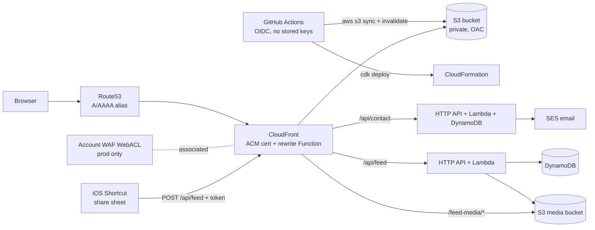

# website

Source for [rickwaterman.com](https://rickwaterman.com) — Rick Waterman's personal site.
A static site (bio, resume, links + feeds, 404, plus the fun pages) built with
[Astro](https://astro.build/) and Tailwind CSS, deployed to S3 + CloudFront with AWS CDK.
Pages are Astro; the one piece that holds interactive state (the fullscreen shader stage)
is a React component hydrated as an Astro island.
It is the hub for the sibling [`blog`](https://github.com/rwaterman/blog) (Hugo) and
[`notes`](https://github.com/rwaterman/notes) (Quartz) sites, which live on subdomains and
share infrastructure owned by this repo.

## Requirements

- Node.js ≥ 22.12 (`engines` in `package.json`)
- AWS CLI + CDK bootstrap in `us-west-2` and `us-east-1` for infra work

## Develop

```sh
npm ci
npm run dev        # http://localhost:4321
npm run check      # astro check (types in .astro and .ts)
npm test           # node:test for src/lib and src/config
npm run build      # static output in ./dist
npm run preview    # serve ./dist locally
npm run test:e2e   # Playwright: builds, serves on :4399, runs e2e/ in headless Chromium
```

End-to-end tests live in `e2e/` and need a one-time `npx playwright install chromium`
(`--with-deps` on Debian/Ubuntu). They cover every page and its background shader, the nav,
the contact form against a stubbed `/api/contact` (the real endpoint only exists behind
CloudFront), and the `/fun` rooms: old `/fun#…` links must land in the right room, every shader in
`src/shaders/` must compile and paint, the stage's editor must survive a failed compile, the Mod Music
File Museum must load, play, pause, seek, advance, and report a failed download, and on `/fun`
the museum and the stage must start each other. Specs that click a stage opener first wait for the
island to hydrate (`waitForStage` in `e2e/helpers.ts`). The tracker spec
answers The Mod Archive's download URL with a module it builds in memory, so it never touches
the network. Headless Chromium renders WebGL2 in software, so the gallery test takes about a minute.
Run one file with `npx playwright test e2e/contact.spec.ts`, or debug with `--ui`.

`SITE` (e.g. `https://dev.rickwaterman.com`) is read at build time for canonical URLs and
the sitemap. Only `SITE=https://rickwaterman.com` links the nav to the prod blog/notes;
the dev deploy and local `npm run dev` (no `SITE`) link to `blog-dev` / `notes-dev`.
Site identity, nav, external links, music profiles, and playlists live in `src/config/site.ts`.
Time-based text is derived, not typed: "N+ years" comes from `careerStartYear` there, and the
copyright year (`src/components/Year.astro`) is rendered at build time and corrected in the
browser. Only the legal page's "Last updated" date is set by hand, when its text changes.

## Content

- **Fun** (`/fun`) — the non-work section, linked from the nav. Two rooms, each its own page,
  joined by tab plates (`src/components/FunNav.astro`): the Mod Music File Museum on `/fun`
  itself and the Shader Collection on `/fun/shaders`. The rooms used to be tabs on one page, so an
  inline script on `/fun` sends `/fun#shaders` and `/fun#<shader id>` on to the shader room, and
  `/fun/music`, the museum's address for a few hours, redirects to `/fun`. The fun pages use the
  Layout's `wide` option (`--container-wide`, 90rem).
- **Fun → Mod Music File Museum** (`/fun`) — a player for classic tracker modules (MOD, S3M, XM, IT, and the
  other formats libopenmpt reads) with a live display: elapsed and remaining time, order /
  pattern / row, speed, tempo and channel count, the song's order list, an LED level meter with
  peak hold per channel, and the pattern scrolling under a fixed playhead. The exhibits run left
  to right along a film-strip reel above the player: drag or scroll it, and the gate in the
  middle names the year and era of the frame under it; the chosen frame is centred in the gate
  and carries a progress bar while it plays. The volume setting is kept in `localStorage`.
  Exhibits live in `src/config/tracker-museum.ts` (composer, group, year, origin, and a Mod
  Archive module id); the one exhibit marked `opens` is where the reel is set when the page
  loads. Each exhibit needs evidence of stature: a top-three party placing, a place on The Mod
  Archive's charts, a landmark demo or game soundtrack, or a landmark in the format's history.
  No module file is in this repo: pressing Play fetches the piece from `api.modarchive.org`,
  and nothing is requested before that. Until Play is pressed, choosing an exhibit or using
  Prev / Next only changes the placard. Playback is libopenmpt compiled to WebAssembly (from
  the `chiptune3` package) running in an AudioWorklet, `src/lib/tracker.worklet.ts`, which
  Vite bundles on its own (`worker.format: 'es'` in `astro.config.mjs` is there for it).
  `src/lib/tracker-player.ts` is the page-side handle and `src/lib/tracker-museum.ts` paints
  the display. When a piece ends the next exhibit starts. Under `prefers-reduced-motion` the
  meters and the scrolling pattern stay off and the numeric readout still runs. A panel on the
  placard lists the file's sample names, where composers left signatures and greetings;
  `withholdSampleText` on an exhibit keeps it off the page for files whose text carries an
  old postal address, phone number, e-mail address, or strong language. To add an exhibit,
  confirm composer and year against a second source, read its sample text, and insert it by
  era, then year; `npm test` checks the ordering and the era ranges. The transport's Random
  shader button opens the shader stage over the music, and on this page the stage's `M` key asks
  the museum for a random module (a `tracker:random` event on `document`). `/fun/shaders` has no
  museum, so its stage has no Mod control.
- **Fun → Shader Collection** (`/fun/shaders`) — GLSL fragment shaders in `src/shaders/*.frag`,
  drawn by `src/lib/shader-engine.ts` (WebGL2, Shadertoy-style `mainImage` + `iResolution` /
  `iTime` / `iMouse`). One shared offscreen GL context renders every visible tile into
  its own 2D canvas, so the page can hold dozens of shaders without hitting the browser's
  context cap; tiles pause offscreen and under `prefers-reduced-motion`. `src/lib/shader-runtime.ts`
  binds the static tiles and the page background to the engine. Every tile has a
  Fullscreen button and the section has "Random shader" and "Shader of the day" (changes each
  UTC day) — all open the fullscreen stage, `src/components/ShaderStage.tsx`, a React island on
  both rooms. On `/fun`, where there is no grid, the stage loads the shader sources once
  the page has loaded. Stage keys: `←` `→` browse, `R` random, `M` random mod (on `/fun`),
  `T` tour (a new shader every 20 seconds), `E` edit, `S` save a PNG, `C` copy link, `Space` pause,
  `Esc` close.
  The editor recompiles the open shader as its GLSL changes and keeps the last good program
  running when a compile fails; edits last until the page reloads. Every shader has a link,
  `/fun/shaders#<id>`, that opens it on the stage. The filter chips narrow the grid by `kind`, and the
  stage browses only what the filter shows. Register new shaders in `src/config/shaders.ts`
  with an `id`, a `kind`, a title, and a caption.
  Every page also draws one shader as a dimmed full-page backdrop — the `background` prop
  on `Layout` names it per page (off under `prefers-reduced-motion`).
- **Theme** — dark for everyone, independent of the OS color-scheme setting. The single
  palette lives in `src/styles/global.css`.
- **Fun → Memes / Cat Photos / Playlists** — drop images into `src/assets/memes/` or
  `src/assets/cats/` (alt text comes from the filename); add playlist links to
  `playlists` in `src/config/site.ts`. Sections without content are not rendered.
- **Links → Feeds** — `public/feeds.opml` is the single copy: parsed at build time for
  the Feeds section of `/links` and served as-is (linked inline as "OPML"). Replace the file to update
  the list.

## Layout

```
src/
  pages/        index, resume, fun/ (index, shaders), links (+ feeds), legal, 404
  components/   Header, Footer, Section, FunNav, TrackerMuseum (.astro);
                ShaderStage (.tsx, React island)
  layouts/      Layout.astro
  config/       site.ts — name, nav, external links, playlists; shaders.ts; tracker-museum.ts
  lib/          opml.ts, fun.ts, slug.ts, shader-engine.ts, shader-runtime.ts,
                shader-filter.ts, tracker-museum.ts, tracker-player.ts, tracker.worklet.ts
                (+ node:test files)
  shaders/      *.frag fragment shader bodies
  assets/       memes/, cats/ (processed by astro:assets)
  styles/       global.css (Tailwind 4 tokens + component classes)
e2e/            Playwright specs (pages, contact form, shader gallery + stage, mod music file museum + rooms)
public/         static assets (resume PDF, feeds.opml, og.png, favicon.svg/.ico, apple-touch-icon.png)
infra/          AWS CDK app (TypeScript)
  bin/website.ts
  lib/shared-stack.ts   infra-deploy role (us-west-2)
  lib/cert-stack.ts     the stage's ACM certificate (us-east-1)
  lib/site-stack.ts     the stage's site (us-west-2)
  lib/feed.ts           share feed construct, used by site-stack.ts
  lambda/feed/          share feed Lambda (index.mjs handler, post.mjs validation)
  lib/redirect-stack.ts rickgwaterman.com → rickwaterman.com 301 (us-east-1)
  lib/site-config.ts    STAGES (account, zone, web ACL flag), resolveStage
  test/                 stage config and stack assertions (node:test, run by `npm test` in infra/)
.github/workflows/
  deploy.yml    build + publish content
  infra.yml     cdk deploy
```

## Architecture



Each AWS account runs one stage: `dev` in `rwaterman-dev` (690084476262) and `prod` in
`rwaterman-prod` (582621605246). The CDK app requires `-c stage=<dev|prod>` and throws when
the credentials belong to another account. The account baseline in
[`aws-orgs`](https://github.com/rwaterman/aws-orgs) owns the hosted zones, the GitHub OIDC
provider, the SES domain identity, and (prod only) the CloudFront WebACL and its SSM
parameter `/account/cloudfront-webacl-arn`; this app imports them.

The home region is `us-west-2`; everything that can live there does (buckets,
distributions, roles, SSM). CloudFront requires its ACM certificate in `us-east-1`, so
that sits in a thin edge stack and is passed to the home-region stacks with CDK
`crossRegionReferences`. DNS is the stage's hosted zone: `dev.rickwaterman.com` in dev,
`rickwaterman.com` in prod. The legacy `rickgwaterman.com` zone (prod only) only holds the
alias records of `WebsiteRedirect`, which 301s every host under it to the same host under
`rickwaterman.com` (`blog.rickgwaterman.com/x?y` → `blog.rickwaterman.com/x?y`); that stack
has nothing regional but its certificate, so it lives entirely in us-east-1.

| Stack | Stage | Region | Contents |
| --- | --- | --- | --- |
| `WebsiteRedirect` | prod | us-east-1 | Legacy-domain redirect: wildcard certificate, CloudFront + Function, apex and `*` alias records |
| `WebsiteCert<Env>` | both | us-east-1 | The stage's DNS-validated ACM certificate |
| `WebsiteShared<Env>` | both | us-west-2 | `website-infra-deploy` role |
| `WebsiteSite<Env>` | both | us-west-2 | Bucket, distribution, DNS, content role, SSM params |

### `WebsiteShared<Env>` — the infra-deploy role

| Resource | Purpose |
| --- | --- |
| `website-infra-deploy` role | Assumed by `infra.yml` through the account's GitHub OIDC provider. Trusts only `repo:rwaterman/website:environment:<stage>` (`StringEquals`); can only assume the CDK bootstrap roles in both regions |

### `WebsiteSite<Env>` — the stage's static site

| Env | Stack | Domain | Deploys from | Content role |
| --- | --- | --- | --- | --- |
| dev | `WebsiteSiteDev` | `dev.rickwaterman.com` | `develop` | `website-content-dev` |
| prod | `WebsiteSiteProd` | `rickwaterman.com` (+ `www` → apex 301) | `main` | `website-content-prod` |

Each environment stack creates: a private, encrypted S3 bucket (prod: `RETAIN`, dev:
destroy + auto-empty); a CloudFront distribution with Origin Access Control and a
viewer-request CloudFront Function (directory-index rewrite, `www` redirect on prod);
Route53 A/AAAA alias records; an OIDC role trusting only the stage's GitHub
environment (`repo:rwaterman/website:environment:<stage>`)
that may only write to that environment's bucket and invalidate its distribution; and
SSM parameters `/website/<env>/bucket-name` and `/website/<env>/distribution-id` that the
deploy workflow resolves at run time, so nothing is hardcoded in CI.

A contact form (`/contact` page → HTTP API → Lambda → SES, served through the same
distribution at `/api/contact`) is enabled per environment via `enableContactForm` in
`site-config.ts`. Abuse controls, outermost first: the account WAF (prod only) issues a silent browser
challenge when `/contact` loads, which sets a 24-hour `aws-waf-token` cookie that the
page's same-origin POST to `/api/contact` carries (curl and scripted clients are stopped
at the edge; the WAF JS SDK is not used because `GetWebACL` only exposes its URL for
ATP/ACFP/Bot Control ACLs), the HTTP API stage throttles at
1 req/s (burst 10), a hidden honeypot field drops bot fills, and the Lambda enforces
DynamoDB counters of 5 messages/min per IP, 5/min per reply-to address, and 20/min
globally. Mail is sent from `contact@<zone>` (`contact@rickwaterman.com` in prod,
`contact@dev.rickwaterman.com` in dev) via the DKIM-signed SES domain identity that the
account baseline creates. The recipient address lives only
in the SecureString parameter `/website/<env>/contact-recipient` (read by the Lambda at run
time) and in its verified SES identity — it never appears in the repo, the client, or
build output. SES identities are regional: the Lambda sends from **us-west-2**, so an
identity verified only in us-east-1 fails with `MessageRejected`. While the account is in
the SES sandbox the recipient must be a verified identity too — swap recipients by
verifying the new address in SES (us-west-2) and updating the parameter; no deploy needed.

### Share feed

The site has no feed page any more; the API behind it is still deployed. An iOS Shortcut
in the share sheet posts a URL or image to `/api/feed`; one Lambda stores it in a DynamoDB
table (images go to a private media bucket served at `/feed-media/*`) and serves the newest
100 posts back from the same endpoint. It is enabled per environment via `enableFeed` in
`site-config.ts`; turning that off removes the API, table, and bucket on the next infra deploy.

| Request | Auth | Body | Result |
| --- | --- | --- | --- |
| `GET /api/feed` | none | — | `{ "items": [{ id, createdAt, url?, title?, note?, image? }] }`, newest first |
| `POST /api/feed` | `x-feed-token` | `{ "url"?, "title"?, "note"?, "image"? }` | `201 { "id" }` |
| `DELETE /api/feed/{id}` | `x-feed-token` | — | `200 { "ok": true }`, image removed too |

The API answers only through CloudFront: the distribution adds an `x-origin-verify` header
that the Lambda checks, so a request sent straight to the API Gateway hostname gets `403`
and cannot bypass the web application firewall (WAF) rate limit. The firewall also masks
`x-feed-token` in its sampled requests.

A post needs a `url` (http or https) or an `image` (base64 JPEG, PNG, GIF, or WebP, up to
4 MB decoded). YouTube links render as an embedded player, images inline, and every other
link as a titled link with its host.

The token is the only write guard. It lives in the SecureString parameter
`/website/<env>/feed-token`, which is created by hand and never appears in the repo:

```sh
aws ssm put-parameter --region us-west-2 --type SecureString \
  --name /website/prod/feed-token --value "$(openssl rand -hex 32)"
aws ssm get-parameter --region us-west-2 --with-decryption \
  --name /website/prod/feed-token --query Parameter.Value --output text
```

To rotate it, overwrite the parameter (`--overwrite`) and update the Shortcut. A running
Lambda caches the old token until its execution environment is recycled; to force that,
change any environment variable on the function or redeploy.

Remove a mis-share with its `id` from `GET /api/feed`:

```sh
curl -X DELETE -H "x-feed-token: $TOKEN" https://rickwaterman.com/api/feed/<id>
```

The post leaves `GET /api/feed` at once. A deleted image can stay in CloudFront and browser caches
for up to five minutes, the cache lifetime set on every upload. If the request fails, send
it again: the post stays listed until its image is gone, so a retry always finishes the job.

#### iOS Shortcut

Build it once in the Shortcuts app; it then appears in every app's share sheet.

1. New Shortcut named "Post to feed". In its details, turn on **Show in Share Sheet** and
   accept **Images** and **URLs** (Safari web pages and text can stay on as well).
2. **Ask for Input** (Text, prompt "Note", allow an empty answer).
3. **Get URLs from Input**, then **If** *URLs* **has any value**: **Get Contents of URL**
   `https://rickwaterman.com/api/feed` with method POST, header `x-feed-token` set to the
   token, and a JSON body of `url` (URLs), `title` (Shortcut Input → Name), and `note`
   (Provided Input). Checking for a URL first matters: a Safari page also contains images,
   and would otherwise be posted as one of them.
4. **Otherwise**, **Get Images from Input**, then:
   1. **Resize Image** to 1600 wide, **Convert Image** to JPEG (quality about 0.8). This
      turns HEIC photos into a format the endpoint accepts and keeps them under 4 MB.
   2. **Base64 Encode** the converted image, line breaks **None**.
   3. **Get Contents of URL** with the same address, method, and header, and a JSON body
      of `image` (Base64 Encoded) and `note` (Provided Input).
5. **End If**, then **Show Notification** with the response so a rejected post is visible.

Share from YouTube, Reddit, Safari, or Photos → **Post to feed** → type a note or leave it
blank. The post is in `GET /api/feed` at once.

## CI/CD

Both workflows use OIDC (`id-token: write`) and run in the GitHub environment that matches
the target: `dev` for `develop`, `prod` for `main`. Each environment carries the variable
`AWS_ACCOUNT_ID` (the stage's account) and is restricted to its branch; no long-lived AWS
keys and no repo secrets exist.

- **`deploy.yml`** — on push to `develop` (→ dev) or `main` (→ prod), or
  `workflow_dispatch` with an `env` choice (the job runs in that environment). Runs
  `astro check` and the unit tests, builds with the env's `SITE`, writes a
  `Disallow: /` `robots.txt` on dev, assumes `website-content-<env>`, syncs `dist/` to S3
  (hashed `_astro/*` assets cached immutable for a year, everything else
  `must-revalidate`), then invalidates `/*`.
- **`infra.yml`** — on push to `develop` or `main` touching `infra/**`. Assumes
  `website-infra-deploy` in the branch's account and runs
  `cdk deploy --all -c stage=<dev|prod>`. A push to `develop` touches only the dev
  account, and a push to `main` only the prod account.

Branching follows git flow: feature branches → `develop` (dev), releases → `main` (prod).

### First-time / local infra deploy

`website-infra-deploy` is created by `WebsiteShared<Env>`, so the very first deploy of a
stage runs locally with admin credentials for that account. The account baseline
(`aws-orgs`) must already exist: it bootstraps CDK in both regions and creates the OIDC
provider, zone, SES identity, and (prod) the WebACL parameter.

```sh
cd infra && npm ci
npx cdk deploy --all -c stage=dev --profile rwaterman-dev
npx cdk deploy --all -c stage=prod --profile rwaterman-prod
```

`resolveStage` rejects credentials from any other account. Other `cdk` commands take the
same context, for example `npx cdk synth -c stage=dev --profile rwaterman-dev`. Add
`-c attachDomains=false` to deploy a distribution with its certificate but no alias domain
names and no Route 53 records, which is how a domain is moved between distributions.

`npm test` in `infra/` runs the stage config and stack assertions.
